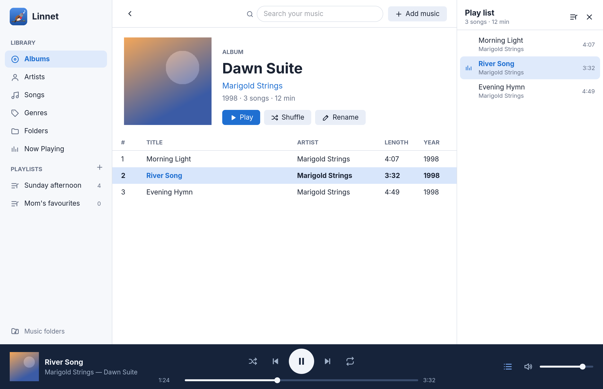

# Linnet


Linnet is a simple music player for Windows (and macOS), written in Skein. It's named after the linnet, a small finch known for its song. Its layout follows Windows Media Player: a library down the left, the music in the middle, the play list on the right and the play controls along the bottom. Text and rows are larger than usual so they're easy to read.



It never changes your music files. Renaming a song, an artist, an album, a genre or a folder, or editing a song's details, only changes what Linnet shows. Removing a song from the library leaves its file where it is.

## Using it

- **Add music:** choose the folder where you keep your music. Linnet reads every song in it and in the folders inside it, including cover art (from the files themselves, or from `cover.jpg`, `folder.jpg` and the `AlbumArt` pictures Windows Media Player leaves). Dropping a folder onto the window adds it too. It checks for new, changed and removed songs each time it starts, and when you choose **File › Check for new music**. A cover changed inside a song's file shows up then too. (VLC keeps covers in a cache filed by artist and album, so Linnet asks for a cover again when VLC's copy is older than the file.)
- **Albums, Artists, Songs and Genres** show the library sorted those ways. Click a tile to open it. In **Songs**, click a column heading to sort by it.
- **Folders** shows your music the way it's arranged on disk, folder by folder. Clicking a folder shows its songs, including the songs in the folders inside it. **Rename** gives a folder a different name in Linnet. The folder on disk keeps its own name.
- **Playing:** double-click a song, or use **Play** or **Shuffle** on an album, artist, genre, folder or playlist. The songs play in order from the one you picked, and appear in the **Play list** on the right.
- **Right-click a song** to play it next, add it to the play list or a playlist, edit its details, use the file's own details again, or remove it from the library.
- **Edit info** changes a song's title, artist, album, album artist, genre, year and track number. Under each changed field it shows what the file itself says.
- **Right-click an album, artist or genre tile** to rename it everywhere at once.
- **Playlists:** make one with **+** under Playlists, with **Save as a playlist** on the play list, or from a song's right-click menu. Right-click a playlist to rename or delete it.
- **Now Playing** shows the current song's cover large. Click the cover in the play bar to get there.

The keyboard shortcuts are Windows Media Player's (Ctrl on Windows, ⌘ on macOS):

| Keys | Does |
| --- | --- |
| Ctrl+P | Play or pause |
| Ctrl+S | Stop |
| Ctrl+B / Ctrl+F | Previous / next song |
| Ctrl+H | Shuffle on or off |
| Ctrl+T | Repeat: off, the whole list, this song |
| Ctrl+Up / Ctrl+Down, Ctrl+M | Louder / quieter, mute |
| Ctrl+E | Search |
| Ctrl+I | Edit the selected song's info |
| Ctrl+1 … Ctrl+6 | Albums, Artists, Songs, Genres, Folders, Now Playing |
| Ctrl+L | Show or hide the play list |
| Ctrl+O | Add a music folder |
| Ctrl+R | Check for new music |
| Esc | Close a dialog |

## VLC

Linnet plays songs with libVLC, through [skein-vlc](https://github.com/crazymevt/skein-vlc). If VLC isn't installed when Linnet starts, it shows a setup window:

- **Windows:** one click downloads VideoLAN's own VLC 3.0.24 zip from download.videolan.org. The build is the one for Linnet's own process: `win64` for an x64 Skein, `winarm64` for a native ARM64 Skein. An x64 Skein running under emulation on an ARM PC gets the x64 build, because that's what it can load. The download is checked against the SHA-256 VideoLAN publishes, and only `libvlc.dll`, `libvlccore.dll` and the audio plugins are kept, in `%APPDATA%\Linnet\vlc`. If the check fails, nothing is kept.
- **macOS and Linux:** it asks you to install VLC (`brew install --cask vlc` on macOS), then **Try again**.

A VLC that Linnet downloaded wins over an installed one. To move to a newer VLC, update `vlc-releases` in `src/linnet/setup.skn` with the new URLs, sizes and the SHA-256 values from the `.sha256` files beside the zips.

## Running it

It needs a Skein release at `../skein-lang/target/release/skein`. Its libraries, [skein-ui](https://github.com/crazymevt/skein-ui) and [skein-vlc](https://github.com/crazymevt/skein-vlc), come from GitHub, pinned to commits in `skein.edn` and `skein.lock`. `skein deps` fetches them, and `skein deps --update` looks them up again after you change a pin.

skein-ui's renderer is a compiled program that isn't in its repository, so a fetched copy has none. `run.sh` and the Makefile use `SKEIN_UI_HOST` if it's set, and otherwise the renderer built in a skein-ui checkout beside this project (`../skein-libs/skein-ui/target/release/skein-ui-host`). To build one in a fresh checkout:

```sh
git clone https://github.com/crazymevt/skein-ui ../skein-libs/skein-ui
(cd ../skein-libs/skein-ui && cargo build --release --locked -p skein-ui-host)
```

```sh
./run.sh
```

Everything Linnet keeps (`library.edn`, `settings.edn`, cover art and a downloaded VLC) lives in its data folder: `%APPDATA%\Linnet` on Windows and `~/Library/Application Support/Linnet` on macOS. Set `LINNET_DATA_DIR` to use another folder, for example to try it without touching your real library:

```sh
LINNET_DATA_DIR=/tmp/linnet-try ./run.sh
```

`skein package` builds an app from `skein.edn`, with the renderer, the icon and `assets/` bundled.

## The icon

`assets/linnet.svg` is the source: a male linnet in spring colours (grey head, crimson forehead and breast, chestnut back, dark wings with white flashes, a forked tail) singing on a branch, on a blue tile. `assets/linnet-small.svg` is a simplified copy for 16 to 32 pixels: the bird fills the tile, with no note or leaves, so it still reads in a title bar or the taskbar.

`tools/make-icons.skn` renders them (it needs `rsvg-convert`, from librsvg):

```sh
../skein-lang/target/release/skein tools/make-icons.skn
```

| File | Use |
| --- | --- |
| `linnet-1024.png` | The package icon (made into `.icns` on macOS) |
| `linnet-256.png` | The logo in the window and the setup screen |
| `linnet-64.png` | Small previews |
| `linnet.ico` | Windows: 16, 20, 24, 32, 40, 48, 64, 128 and 256 pixels, each a PNG. The small variant covers 16 to 32. |

## CI and releases

GitHub Actions builds and tests Linnet on macOS (arm64), Linux (x86-64 and arm64) and Windows (x86-64 and arm64). `.github/actions/prepare` does the setup both workflows share:

- **Skein:** built from skein-lang's `main`. On Windows it uses clang and skein-lang's MMTk patch, as skein-lang's own CI does.
- **Libraries:** `skein deps` fetches the pinned skein-ui and skein-vlc, and the renderer is built inside the fetched skein-ui.
- **libVLC:** from apt on Linux. On macOS it's VideoLAN's own disk image, pinned by version and SHA-256 in the setup action. On Windows it's downloaded with `tools/install-vlc.skn`, the same code as Linnet's setup window, so CI also checks VideoLAN's real zips. On macOS and Windows the unpacked VLC is cached, so VideoLAN's servers are asked only when a pin changes. (Keep the macOS pin in step with `vlc-releases` in `src/linnet/setup.skn`.)

CI machines have no sound card, so the tests run VLC with `LINNET_VLC_OPTIONS=--aout=adummy`.

- **CI** (`.github/workflows/ci.yml`) runs the tests on every push and pull request (except ones that only change Markdown, `docs/` or the licence), and keeps a screenshot of each view from every platform as a build artifact. Only macOS can fail the run for now. The Linux jobs wait on skein-ui's renderer, which isn't proven on Linux yet, and the Windows jobs wait on Skein's FFI there.
- **Releases** (`.github/workflows/release.yml`): push a tag that matches `skein.edn`'s `:version`, such as `v0.1.0`. Each platform is tested and packaged, then a **draft** release is made with every package that built, to check and publish by hand.
  - **macOS:** `Linnet.app` (zipped) and a command-line archive.
  - **Linux:** a command-line archive.
  - **Windows:** a zip from `skein package --windows` where Skein has it, or the command-line archive until then.

  A platform whose job fails is left out of the draft rather than stopping it.

The packages still need VLC on macOS and Linux. On Windows, Linnet downloads it on first start. Nothing is signed yet: macOS shows its unidentified-developer warning, and Windows SmartScreen shows its own.

## How it's made

| File | Part |
| --- | --- |
| `src/linnet/library.skn` | The library as data: tracks, the listener's edits over the files' tags, folder names, playlists, grouping and sorting. Pure functions. |
| `src/linnet/store.skn` | Saving the library and settings as EDN in the data folder. |
| `src/linnet/scan.skn` | Finding audio files in folders and reading their tags and cover art with libVLC. |
| `src/linnet/player.skn` | The play queue, shuffle and repeat, and a watcher that moves on when a song ends. |
| `src/linnet/setup.skn` | Finding libVLC, and downloading VLC on Windows. |
| `src/linnet/theme.skn`, `widgets.skn`, `app.skn` | The look, the building blocks (seek bar, song table, tiles) and the window. |

## Tests

```sh
make test
```

The tests use `tests/fixtures/music`, a small library of silent, tagged MP3s in folders, some with cover art and one with no tags. They play through the real audio output, but the songs are silent. The window tests run headless. `make fixtures` rebuilds the fixtures with ffmpeg. `make screenshots` saves a picture of each view to `shots/`. `make readme-screenshot` remakes `docs/screenshot.png` (its script gives the silent fixture songs real-looking lengths, in a throwaway library).

The VLC download is tested against a local server serving a small zip laid out like VideoLAN's, so the tests download nothing.
